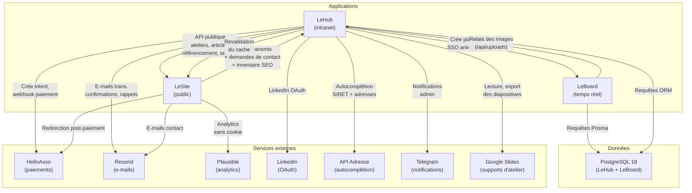

# Le SI de La Fresque Systémique

La Fresque Systémique organise des ateliers de sensibilisation aux enjeux systémiques en présentiel et en ligne. Son système d'information repose sur trois applications web interconnectées qui gèrent ensemble les membres, les ateliers, les inscriptions, les paiements et l'animation en direct. Cette documentation en explore l'architecture, le fonctionnement et les points d'entrée pour un développeur qui doit le reprendre, le debuguer ou le faire évoluer.

## À qui s'adresse cette documentation

Cette documentation vise le transfert de compétences vers un développeur qui reprend le SI de zéro ou qui en maintient une partie. Elle couvre l'architecture des trois applications, leurs échanges, leur modèle de données, les services externes qui les alimentent, et les pièges courants lors du lancement local ou du déploiement.

Elle ne contient délibérément pas : les procédures d'accès au serveur, les chemins d'exploitation, les identifiants de services cloud, les secrets ou variables d'environnement sensibles. Ces informations vivent dans un repo privé distinct appelé LeRunbook, accessible aux admins du projet.

## Les trois applications

| Application | Rôle | Adresse publique | Stack |
|---|---|---|---|
| **LeHub** | L'intranet de l'association et le moteur du SI : membres, ateliers, inscriptions, paiements, contenus, e-mails, badges numériques, et depuis l'été 2026 le référencement de LeSite et ses demandes de contact. C'est la source de vérité pour toute la donnée. | hub.fresquesystemique.org (et badge.) | Next.js 16.4, Node 22, PostgreSQL 18 + Prisma 7, NextAuth v5, Resend, HelloAsso, Google Slides |
| **LeSite** | Le site public sur l'apex fresquesystemique.org : découvrir la démarche, consulter l'agenda, s'inscrire, lire le blog. Pas de base de données propre, et plus aucun secret d'authentification : il consomme l'API du Hub. | fresquesystemique.org | Next.js 16.4, React 19, Tailwind 4, Leaflet (carte), Vitest |
| **LeBoard** | Le plateau collaboratif temps réel pour les ateliers en ligne : 283 cartes, post-its, flèches, tout se synchronise en direct. Ne s'ouvre pas sous 1024 px. Partage la même base que LeHub. | board.fresquesystemique.org | Next.js 16.4 derrière un serveur Node maison, Socket.io 4, Konva 9, PostgreSQL 18 + Prisma 7 (partagée) |

## Qui parle à qui

Deux choses que ce schéma dit, et qui se perdent facilement :

- **LeSite et LeHub se parlent dans les deux sens.** LeSite lit le contenu et le référencement ; le Hub lui envoie des ordres de revalidation et lui demande l'inventaire de ses pages publiques.
- **LeBoard ne parle à aucun service externe.** Même les supports Google Slides passent par le Hub, et leurs images sont relayées par LeBoard depuis sa propre origine.

## Les outils que l'association n'a pas écrits

Trois applications, mais pas seulement. La vie de l'association passe aussi par des outils du marché, et deux d'entre eux portent des dépendances dont les applications ne se relèvent pas seules :

| Outil | Rôle |
|---|---|
| **Google Workspace** (Google for Nonprofits) | Les boîtes `@fresquesystemique.org`, le Drive partagé, les visios Meet. C'est aussi le Drive qui héberge les supports Google Slides que LeHub lit et exporte |
| **Signal** | La boucle de coordination du bureau : les personnes, les décisions |
| **Telegram** | Le fil technique : alertes du monitoring et notifications d'administration |
| **LinkedIn** | La page de l'association, la connexion des membres au Hub, et l'attestation de badge |

Le courrier du domaine suit **deux chemins distincts** : les boîtes humaines chez Google, les e-mails des applications par Resend. C'est la source de confusion la plus fréquente du SI.

La page [Les outils de l'association](/si/outils) détaille tout cela, y compris ce qui casse quand un compte Google disparaît.

## Par où commencer

### Si vous ne lisez qu'une chose

La page [Pièges connus](/si/pieges) : trente-cinq pièges du SI qui échouent **en silence**, du run de déploiement vert qui n'a rien déployé à l'image refusée sans trace dans les journaux.

### Trois parcours de lecture selon votre besoin

**Je reprends le SI de zéro.** Commencez par cette page, puis explorez chacune des trois applications en suivant le même parcours : fonctionnalités, stack technique, modèle de données, lancement en local, déploiement. Les sections des trois outils — [LeHub](/lehub/), [LeSite](/lesite/) et [LeBoard](/leboard/) — détaillent chacune cette structure.

**Je dois corriger un bug sur une application.** Allez directement à la section correspondante ([LeHub](/lehub/), [LeSite](/lesite/) ou [LeBoard](/leboard/)), lisez son modèle de données pour localiser le bug, puis consultez sa page « Lancement en local » pour reproduire le problème et tester votre correction. Consultez aussi les [Pièges connus](/si/pieges) pour vérifier que le bug n'est pas l'un des trente-cinq pièges documentés.

**Je reprends la coordination, pas le code.** Lisez [Les outils de l'association](/si/outils) : qui porte quoi, et surtout où vit chaque information — un atelier dans le Hub, une décision de bureau dans le Drive, une alerte sur Telegram.

**Je dois opérer la production.** Consultez le LeRunbook, le repo privé qui détaille les procédures d'accès au serveur, les scripts de sauvegarde, les alertes de monitoring et les rollback d'urgence. Ce qui suit est de la documentation de code, pas d'exploitation.
