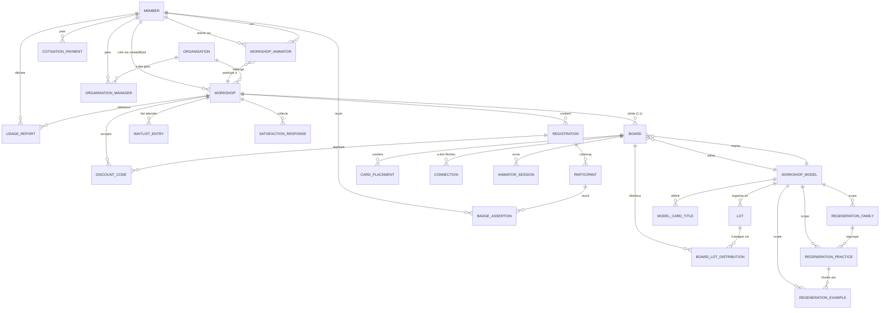

# Modèle de données

Le schéma Prisma (`prisma/schema.prisma`) est la source unique de vérité pour le modèle de données : 35 modèles sur PostgreSQL 18, avec Prisma 7 et un soft delete sur certaines entités (`deletedAt`).

Depuis Prisma 7, le bloc `datasource` ne porte plus l'URL de connexion (elle vit dans `prisma.config.ts` et `lib/prisma.ts`) et le client est généré dans `generated/prisma`, hors git. Les modèles du plateau (`Board`, `CardPlacement`, `Connection`, `AnimatorSession`, `Lot`, `BoardLotDistribution`, `ModelCardTitle`, `CardMeta`) sont partagés avec LeBoard, qui lit et écrit la même base.

## Modèles métier

### Member

Représente un membre de l'association. Le champ `role` vaut `adherent` par défaut ; seuls `animateur`, `formateur` et les comptes `isAdmin` accèdent au Hub.

| Champ | Type | Rôle |
|---|---|---|
| `id` | String (CUID) | Identifiant unique |
| `email` | String (unique) | Email de connexion |
| `firstName`, `lastName` | String | Identité |
| `passwordHash` | String? | Hash bcrypt (credentials auth) |
| `gender` | String | "masculin" / "feminin" / "neutre" (défaut) — appliqué aux templates emails |
| `role` | String | "adherent" (défaut) / "animateur" / "formateur" — rôle pédagogique |
| `isAdmin` | Boolean | Accès espace admin (`false` défaut) — **indépendant** du `role` |
| `habilitationAnimation` | String? | "grand_public" / "professionnelle" / null |
| `habilitationFormation` | String? | "grand_public" / "professionnelle" / null |
| `habilitationExpiry` | DateTime? | Date d'expiration habilitations |
| `linkedinId` | String? (unique) | ID LinkedIn OAuth |
| `linkedinUrl`, `websiteUrl` | String? | URLs profil |
| `avatarUrl` | String? | URL avatar custom (fallback Gravatar) |
| `bio`, `tagline` | String? | Bio et phrase d'accroche « En une ligne » |
| `location` | String? | Localisation |
| `phone` | String? | Téléphone |
| `badges` | String[] | IDs badges obtenus (dénormalisé pour perf) |
| `directoryConsent` | Boolean | Opt-in annuaire public |
| `cotisationStatus` | String | "inactive" (défaut) / "active" / "expired" — synchro HelloAsso webhook |
| `cotisationExpiry` | DateTime? | Date expiration cotisation |
| `licenceType` | String? | "professionnelle" / "citoyenne" / "interne" — "interne" exempt cotisation |
| `invitationToken` | String? (unique) | Token invitation pour nouveaux membres |
| `passwordResetToken` | String? (unique) | Token reset password (avec expiry) |
| `createdAt`, `updatedAt`, `deletedAt` | DateTime | Timestamps (soft delete) |

**Relations** : crée des `Workshop`, anime via `WorkshopAnimator`, rapports via `UsageReport`, badges via `BadgeAssertion`, gest. organisations via `OrganisationManager`, cotisations via `CotisationPayment`.

### Workshop

Représente un atelier ou formation (public ou privé, grand public ou inter-organisations).

| Champ | Type | Rôle |
|---|---|---|
| `id` | String (CUID) | Identifiant unique |
| `slug` | String (unique) | Slug URL publique |
| `title`, `description` | String | Titre et description |
| `date` | DateTime | Date/heure de début |
| `duration` | Int | Durée en minutes |
| `eventType` | String | "atelier" (défaut) / "formation" |
| `type` | String | Type atelier technique (ex: "game", "discussion") |
| `format` | String | Format (ex: "en_ligne", "presentiel", "hybride") |
| `timezone` | String | Timezone ("Europe/Paris" défaut) |
| `language` | String | "fr" (défaut) |
| `location`, `address`, `city`, `postalCode`, `region`, `department` | String? | Adresse (autocompletée BAN) |
| `theme` | String? | Thème |
| `targetPublic` | String | "grand_public" (défaut) / "inter_organisations" |
| `context` | String? | Contexte de l'atelier, dont `benevole` (cadre pro bono, réservé au public associatif) |
| `capacity` | Int | Nombre de places |
| `price`, `priceSolidaireHT`, `priceClassiqueHT`, `priceSoutienHT` | Float | Tarifs historiques de l'atelier (HT), utilisés quand `priceTiers` est vide |
| `priceTiers` | Json? | **Grille tarifaire libre** `[{ id, label, description, amountHT }]`, 8 tarifs maximum. Prime sur les colonnes ci-dessus. Lue uniquement par `lib/price-tiers.ts` |
| `status` | String | "draft" (défaut) / "published" / "cancelled" |
| `createdById` | String? | Animateur créateur (relation `Member`). **`NULL` sur les ateliers importés de Pretix** : le responsable est le lead `WorkshopAnimator`, pas ce champ |
| `organisationId` | String? | Rattachement organisation (inter-organisations) |
| `waitlistEnabled` | Boolean | Liste d'attente active |
| `seoTitle`, `metaDescription`, `focusKeyphrase`, `seoScore`, `readabilityScore` | String?/Int? | Champs SEO, distincts du contenu éditorial, exposés à LeSite par l'API publique |
| `createdAt`, `updatedAt`, `deletedAt` | DateTime | Timestamps (soft delete) |

Le modèle de plateau d'un atelier en ligne n'est pas porté par `Workshop` mais par `Board.modelId`.

**Relations** : `createdBy` (Member), `organisation` (Organisation), animateurs via `WorkshopAnimator`, inscriptions via `Registration`, liste d'attente via `WaitlistEntry`, plateau via `Board`, résultats satisfaction via `SatisfactionResponse`, rapports utilisation via `UsageReport`, codes avantage via `DiscountCode`.

### Registration

Représente l'inscription d'un participant à un atelier.

| Champ | Type | Rôle |
|---|---|---|
| `id` | String (CUID) | Identifiant unique |
| `workshopId`, `workshop` | String + FK | Atelier |
| `firstName`, `lastName`, `email`, `phone` | String | Données participant |
| `paymentStatus` | String | "pending" (défaut) / "paid" / "refunded" / "voucher" / "blocked" |
| `helloassoCheckoutIntentId` | String? | ID intention de paiement HelloAsso |
| `helloassoOrderId` | String? | ID ordre HelloAsso (webhook) |
| `amountHT`, `amountTTC`, `vatAmount` | Float | Montants facturés |
| `discountCodeId` | String? | Code avantage appliqué |
| `discountAmountHT` | Float | Réduction appliquée |
| `invoiceUrl` | String? | Colonne héritée : **rien ne l'écrit aujourd'hui**, le reçu de paiement est émis par HelloAsso |
| `priceTierLabel` | String? | Nom du tarif choisi, figé à l'inscription : renommer un tarif de l'atelier ensuite ne touche pas les inscriptions existantes |
| `refundedAt` | DateTime? | Remboursement constaté (y compris décidé depuis le back-office HelloAsso, cf. `lib/refund-sync.ts`) |
| `attended` | Boolean? | Présence pointée |
| `participantId` | String? | Lien CRM `Participant` (créé/mis à jour au webhook) |
| `cancellationToken` | String? (unique) | Token d'annulation public (lien email) |
| `cancelledAt` | DateTime? | Date annulation |
| `refundMethod` | String? | "refund" / "voucher" / "blocked" — décision remboursement |
| `surveyToken` | String? (unique) | Token questionnaire satisfaction |
| `surveySentAt`, `surveyRespondedAt` | DateTime? | Envoi et réponse satisfaction |
| `reminderSentAt` | DateTime? | Rappel J-2 envoyé |
| `createdAt`, `updatedAt` | DateTime | Timestamps |
| **Unique** | `[workshopId, email]` | Une seule inscription par email par atelier |

**Relations** : workshop, participant (CRM), code avantage.

### Participant

Représente un participant dans le CRM (déduplication par email).

| Champ | Type | Rôle |
|---|---|---|
| `id` | String (CUID) | Identifiant unique |
| `email` | String (unique) | Email de déduplication |
| `firstName`, `lastName`, `phone` | String | Données contact |
| `tags` | String[] | Étiquettes texte libre (admin) |
| `notes` | String? | Notes internes admin |
| `firstSeenAt` | DateTime | Première inscription enregistrée |
| `createdAt`, `updatedAt`, `deletedAt` | DateTime | Timestamps (soft delete) |

**Relations** : inscriptions via `Registration`, badges via `BadgeAssertion`.

### WorkshopAnimator

Liaison N-N atelier ↔ animateur avec rôle (lead/co) et tracking « nouveaux inscrits ».

| Champ | Type | Rôle |
|---|---|---|
| `id` | String (CUID) | Identifiant unique |
| `workshopId` | String | Atelier |
| `memberId` | String | Animateur |
| `role` | String | "lead" / "co" — lead = responsable |
| `lastViewedAt` | DateTime | Timestamp dernière visite fiche atelier → déclenche le badge "nouveaux inscrits" |
| **Unique** | `[workshopId, memberId]` | Un seul rôle par animateur par atelier |

### Organisation

Fiches organisation pour ateliers inter-organisations (lookup SIRET auto).

| Champ | Type | Rôle |
|---|---|---|
| `id` | String (CUID) | Identifiant unique |
| `name` | String (unique) | Nom organisation |
| `type` | String? | Type (entreprise, association, etc.) |
| `siret` | String? (unique) | SIRET (lookup API recherche-entreprises) |
| `address`, `city`, `postalCode` | String? | Adresse |
| `notes` | String? | Notes internes |
| `createdAt`, `updatedAt` | DateTime | Timestamps |

**Relations** : ateliers via `Workshop`, gestionnaires via `OrganisationManager`.

### OrganisationManager

Liaison N-N organisation ↔ membre (gestionnaire).

| Champ | Type | Rôle |
|---|---|---|
| `id` | String (CUID) | Identifiant unique |
| `organisationId`, `memberId` | String | Organisation et gestionnaire |
| `createdAt` | DateTime | Timestamp |
| **Unique** | `[organisationId, memberId]` | Un seul rôle gestionnaire par membre par org |

### WaitlistEntry

Liste d'attente pour ateliers complets.

| Champ | Type | Rôle |
|---|---|---|
| `id` | String (CUID) | Identifiant unique |
| `workshopId`, `workshop` | String + FK | Atelier |
| `firstName`, `lastName`, `email`, `phone` | String | Données |
| `position` | Int | Position dans la file |
| `notifiedAt` | DateTime? | Notification d'ouverture de place |
| `createdAt` | DateTime | Timestamp |
| **Unique** | `[workshopId, email]` | Une seule entrée par email par atelier |

### CotisationPayment

Paiements de cotisation tracés (source HelloAsso).

| Champ | Type | Rôle |
|---|---|---|
| `id` | String (CUID) | Identifiant unique |
| `memberId`, `member` | String + FK | Adhérent |
| `helloassoOrderId` | String (unique) | ID ordre HelloAsso |
| `licenceType` | String | Licence achetée (professionnelle / citoyenne / interne) |
| `amountCents` | Int | Montant en centimes |
| `paidAt` | DateTime | Date paiement |
| `createdAt` | DateTime | Timestamp |

### BadgeAssertion

Badges Open Badges 3.0 (VerifiableCredential JWT signé EdDSA).

| Champ | Type | Rôle |
|---|---|---|
| `id` | String (CUID) | Identifiant unique |
| `type` | String | "ANIMATOR_PUBLIC" / "ANIMATOR_PRO" / "TRAINER_PUBLIC" / "TRAINER_PRO" / "PARTICIPANT" |
| `memberId`, `participantId` | String? | Bénéficiaire (Member ou Participant) |
| `recipientEmail`, `recipientName` | String | Données pour assertion |
| `signedJwt` | String (Text) | JWT EdDSA signé (VerifiableCredential OB3) |
| `issuedAt` | DateTime | Date émission |
| `revoked` | Boolean | Révocation |
| `createdAt` | DateTime | Timestamp |

### UsageReport

Déclarations de droits d'utilisation professionnels (rapports pédagogiques).

| Champ | Type | Rôle |
|---|---|---|
| `id` | String (CUID) | Identifiant unique |
| `memberId`, `workshopId` | String | Animateur et atelier référence |
| `usageContext`, `organisationName`, `participantCount` | String | Contexte d'utilisation |
| `amountHT`, `amountTTC` | Float | Montants facturés |
| `paymentStatus` | String | "pending" / "paid" |
| `helloassoCheckoutIntentId`, `helloassoOrderId` | String? | Traçabilité paiement HelloAsso |
| `invoiceUrl` | String? | Colonne héritée, jamais écrite (même remarque que sur `Registration`) |
| `createdAt`, `updatedAt` | DateTime | Timestamps |

### Article

Actualités du Hub (publiées sur LeSite).

| Champ | Type | Rôle |
|---|---|---|
| `id` | String (CUID) | Identifiant unique |
| `slug` | String (unique) | Slug URL |
| `title`, `excerpt`, `body` | String | Contenu Markdown GFM |
| `category` | String | Catégorie article |
| `authorName`, `authorRole` | String | Auteur (dropdown admin) |
| `imageUrl`, `imageCaption` | String? | Image et légende (upload → WebP) |
| `published` | Boolean | Publication |
| `publishedAt` | DateTime? | Date publication |
| `wordCount` | Int | Nombre de mots (sert à l'analyse SEO) |
| `seoTitle`, `metaDescription`, `focusKeyphrase`, `seoScore`, `readabilityScore` | String?/Int? | Champs SEO, distincts de `title`/`excerpt` |
| `createdAt`, `updatedAt` | DateTime | Timestamps |

### Resource

Médiathèque (articles, livres, podcasts, vidéos, rapports).

| Champ | Type | Rôle |
|---|---|---|
| `id` | String (CUID) | Identifiant unique |
| `title`, `description` | String | Titre et description |
| `type` | String? | Type (article, book, podcast, video, report) |
| `themes` | String[] | Thématiques (multi-select) |
| `category` | String | "documentaire" (défaut) |
| `workshopType` | String? | Type atelier associé |
| `authors` | String[] | Auteurs |
| `date` | DateTime? | Date publication |
| `languageLinks`, `titleLinks` | Json | Traductions et liens par langue |
| `isPublic` | Boolean | Visibilité |
| `createdAt` | DateTime | Timestamp |

### PedagogicalVersion

Supports pédagogiques versionnés (section + slot, accès animateur/formateur).

| Champ | Type | Rôle |
|---|---|---|
| `id` | String (CUID) | Identifiant unique |
| `section`, `slot` | String | Section et slot (ex: "formation", "1") |
| `version` | String | Version (ex: "v1.0") |
| `link` | String | URL ressource |
| `date` | DateTime? | Date version |
| `access` | String | "animateur" (défaut) / "formateur" |
| `isCurrent` | Boolean | Version courante |
| `notes` | String? | Notes |
| `createdAt` | DateTime | Timestamp |

### DiscountCode

Codes avantage (réduction % ou montant fixe).

| Champ | Type | Rôle |
|---|---|---|
| `id` | String (CUID) | Identifiant unique |
| `code` | String (unique) | Code (ex: "NOEL20") |
| `percentOff`, `amountOffTTC` | Int/Float? | Réduction (l'une ou l'autre) |
| `maxUses` | Int? | Limite d'utilisations |
| `workshopId` | String? | Restriction à un atelier (optionnel) |
| `restrictedToEmail` | String? | Restriction email (optionnel) |
| `expiresAt` | DateTime? | Expiration |
| `active` | Boolean | Activité |
| `createdAt`, `updatedAt` | DateTime | Timestamps |

### SatisfactionResponse

Réponses au questionnaire post-atelier.

| Champ | Type | Rôle |
|---|---|---|
| `id` | String (CUID) | Identifiant unique |
| `workshopId`, `workshop` | String + FK | Atelier |
| `answers` | Json | Réponses structurées (JSON) |
| `comment` | String? | Commentaire libre |
| `submittedAt` | DateTime | Date réponse |

### Settings

Paramètres globaux (singleton, `id='global'`).

| Champ | Type | Rôle |
|---|---|---|
| `id` | String | "global" (unique) |
| `workshopModerationOn` | Boolean | Flag modération ateliers |
| `siteChantierMode` | Boolean | Mode chantier site public |
| `priceInterneHT`, `pricePrestationHT`, `vatRate` | Float | Tarifications legacy |
| `priceSolidaireHT`, `priceClassiqueHT`, `priceSoutienHT` | Float | Prix par défaut (legacy, overridable par `PricingPolicy`) |
| **Identité** | `associationName`, `logoPath`, `address`, `postalCode`, `city`, `contactEmail` | Infos association |
| **Mentions légales** | `siret`, `rna`, `tvaNumber`, `tvaApplicable` | Données légales |
| **Email** | `emailFrom`, `emailFromName`, `emailReplyTo`, `resendApiKey` | Config Resend |
| | `emailFromBilling`, `emailFromSupport` | Adresses expéditrices par catégorie (`lib/email-categories.ts`) ; vides, les gabarits partent de `emailFrom` |
| **HelloAsso** | `helloassoClientId`, `helloassoClientSecret`, `helloassoOrgSlug`, `helloassoEnv` | Identifiants HelloAsso (prod) |
| | `helloassoSandboxClientId`, `helloassoSandboxClientSecret`, `helloassoSandboxOrgSlug` | Identifiants HelloAsso (sandbox) |
| | `helloassoRefundEnabled` | Remboursement HelloAsso auto (en attente privilège `RefundManagement`) |
| **Telegram** | `telegramBotToken`, `telegramChatId` | Notifs admin |
| **Logo.dev** | `logoDevPublishableKey`, `logoDevSecretKey` | API Logo.dev (signatures digitales optionnel) |
| `emailsEnabled` | Json? | Toggle activation/désactivation des gabarits d'e-mail |
| **SEO** | `seoTitleTemplate`, `seoDefaultDesc`, `seoDefaultOgImage`, `seoSearchConsoleTag` | Réglages de référencement globaux du site public |
| | `seoIndexingEnabled` | Autorise l'indexation de LeSite. **`false` par défaut**, et le reste tant que le mode chantier n'est pas levé |
| `updatedAt` | DateTime | Timestamp |

:::warning `tvaApplicable` porte une décision fiscale, pas un détail d'affichage
L'association est assujettie à la TVA mais bénéficie de la **franchise en base** (art. 293 B du CGI) : elle ne la collecte pas et ne la récupère pas. `tvaApplicable` est donc à `false`, et `vatRate` ne décrit que le taux qui s'appliquerait si la franchise sautait. Tout code qui calcule ou affiche un prix passe par `lib/vat.ts`, seul endroit qui tranche, et les documents portent la mention « TVA non applicable - article 293 B du CGI ».
:::

### PricingPolicy

Tarification par `eventType × publicType` (matrice 3-tiers).

| Champ | Type | Rôle |
|---|---|---|
| `id` | String (CUID) | Identifiant unique |
| `eventType`, `publicType` | String | Clés (ex: "atelier", "grand_public") |
| `solidaireHT`, `classiqueHT`, `soutienHT` | Float | Prix par tier |
| **Unique** | `[eventType, publicType]` | Une seule politique par combinaison |

### FormatPricing

Prix hors taxes par format d'atelier. Table d'appoint très simple, distincte de `PricingPolicy` : là où `PricingPolicy` croise un type d'événement et un type de public pour produire trois tarifs, `FormatPricing` associe un prix unique à un format.

| Champ | Type | Rôle |
|---|---|---|
| `id` | String (CUID) | Identifiant unique |
| `format` | String | Format d'atelier, unique |
| `priceHT` | Float | Prix hors taxes pour ce format |

**Relations** : aucune. La table est lue par clé `format`.

### NotificationConfig

Configuration notifications email/Telegram par type d'événement admin.

| Champ | Type | Rôle |
|---|---|---|
| `id` | String (CUID) | Identifiant unique |
| `eventType` | String (unique) | Type événement (ex: "rapport_utilisation") |
| `emailEnabled`, `telegramEnabled` | Boolean | Canaux actifs |

### PendingLink

Liaisons OAuth LinkedIn en attente (TTL 15 min).

| Champ | Type | Rôle |
|---|---|---|
| `id` | String (CUID) | Identifiant unique |
| `token` | String (unique) | Token lien |
| `linkedinId`, `linkedinName`, `linkedinEmail` | String | Données LinkedIn |
| `expiresAt` | DateTime | Expiration |
| `createdAt` | DateTime | Timestamp |

### WorkshopModel

Modèles de plateau LeBoard.

| Champ | Type | Rôle |
|---|---|---|
| `id` | String (CUID) | Identifiant unique |
| `name` | String | Nom modèle |
| `language` | String | "fr" (défaut) |
| `plateauId` | String? | Plateau du catalogue (`lib/plateaux.ts`) dont la version suit les étapes |
| `slidesFileId`, `slidesFileName` | String? | Support Google Slides de la version : **un seul fichier par modèle**, dans lequel chaque lot choisit ses diapositives |
| `createdAt`, `updatedAt` | DateTime | Timestamps |

**Relations** : lots via `Lot`, boards via `Board`, titres cartes via `ModelCardTitle`, et les trois tables de l'étape Régénération (`RegenerationFamily`, `RegenerationPractice`, `RegenerationExample`).

### Lot

Lots de cartes d'un modèle plateau.

| Champ | Type | Rôle |
|---|---|---|
| `id` | String (CUID) | Identifiant unique |
| `modelId`, `model` | String + FK | Modèle |
| `name` | String | Nom lot |
| `order` | Int | Ordre |
| `stageId` | String? | ID étape LeBoard |
| `kind` | String? | Type lot |
| `cardIds` | String | IDs cartes (JSON ou CSV) |
| `contentType` | String | "cards" (défaut) / "slides" |
| `slidesData` | String? | Données diapositives |

**Relations** : distributions via `BoardLotDistribution`.

### Board

Plateau en ligne d'un atelier (propriété LeBoard, accès en écriture du Hub).

| Champ | Type | Rôle |
|---|---|---|
| `id` | String (CUID) | Identifiant unique |
| `workshopId` | String (unique) | Atelier |
| `workshopTitle` | String | Titre (dénormalisé) |
| `token` | String (unique) | Token d'accès |
| `language` | String | "fr" (défaut) |
| `status` | String | "active" (défaut) |
| `isTraining` | Boolean | Atelier test (24h expiration) |
| `expiresAt` | DateTime? | Expiration |
| `modelId` | String? | Modèle plateau |
| `activeStageId` | String | ID étape active (persisté pour redémarrage) |
| `createdAt`, `updatedAt` | DateTime | Timestamps |

**Relations** : placements via `CardPlacement`, connexions via `Connection`, distributions via `BoardLotDistribution`, sessions via `AnimatorSession`.

### CardPlacement

Positionnement d'une carte sur un plateau.

| Champ | Type | Rôle |
|---|---|---|
| `id` | String (CUID) | Identifiant unique |
| `boardId`, `cardId` | String | Plateau et ID carte |
| `x`, `y` | Float | Coordonnées |
| `rotation` | Float | Rotation en degrés |
| `zIndex` | Int | Profondeur |
| `flipped` | Boolean | Verso retourné |
| `updatedAt` | DateTime | Timestamp |

### Connection

Flèche/connexion entre cartes sur un plateau.

| Champ | Type | Rôle |
|---|---|---|
| `id` | String (CUID) | Identifiant unique |
| `boardId` | String | Plateau |
| `fromId`, `toId` | String | Cartes source/destination |
| `label` | String? | Label flèche |
| `createdAt` | DateTime | Timestamp |

### AnimatorSession

Sessions SSO animateur (token signé, TTL).

| Champ | Type | Rôle |
|---|---|---|
| `id` | String (CUID) | Identifiant unique |
| `boardId`, `memberId` | String | Plateau et animateur |
| `pseudo` | String | Pseudonyme animateur |
| `expiresAt` | DateTime | Expiration session |
| `createdAt` | DateTime | Timestamp |

### ModelCardTitle

Titres de cartes personnalisés par modèle.

| Champ | Type | Rôle |
|---|---|---|
| `id` | String (CUID) | Identifiant unique |
| `workshopModelId`, `cardId` | String | Modèle et ID carte |
| `customTitle` | String | Titre personnalisé |
| **Unique** | `[workshopModelId, cardId]` | Un seul titre par carte par modèle |

### BoardLotDistribution

Distribution des lots sur un plateau (timestamp + mode de lancement).

| Champ | Type | Rôle |
|---|---|---|
| `id` | String (CUID) | Identifiant unique |
| `boardId`, `lotId` | String | Plateau et lot |
| `mode` | String | "distribute" (défaut) / "popcorn" |
| `distributedAt` | DateTime | Timestamp distribution |
| **Unique** | `[boardId, lotId]` | Un seul record par lot par plateau |

### CardMeta

Titres de cartes personnalisés legacy (hors modèle).

| Champ | Type | Rôle |
|---|---|---|
| `id` | String (CUID) | Identifiant unique |
| `cardId` | String | ID carte |
| `language` | String | Langue |
| `customTitle` | String? | Titre personnalisé |
| **Unique** | `[cardId, language]` | Un seul titre par carte par langue |

### SeoMeta

Référencement d'une page statique de LeSite, édité dans `/admin/seo` et lu par LeSite à chaque rendu. Une ligne par chemin.

| Champ | Type | Rôle |
|---|---|---|
| `id` | String (CUID) | Identifiant unique |
| `path` | String (unique) | Chemin public de la page (ex: `/offres/ateliers`) |
| `seoTitle`, `metaDescription`, `focusKeyphrase` | String? | Titre SEO, meta description, mot-clé cible |
| `ogImagePath` | String? | Image OpenGraph propre à la page |
| `noindex` | Boolean | Exclut la page de l'indexation |
| `seoScore`, `readabilityScore` | Int? | Derniers scores calculés par l'analyse Yoast |
| `createdAt`, `updatedAt` | DateTime | Timestamps |

**Relations** : aucune. Le rapprochement avec une page se fait par `path`, ce qui veut dire qu'une URL renommée côté LeSite laisse sa ligne orpheline.

### ContactRequest

Demandes du formulaire de contact de LeSite, persistées dans le Hub et suivies dans `/admin/contact-requests`.

| Champ | Type | Rôle |
|---|---|---|
| `id` | String (CUID) | Identifiant unique |
| `firstName`, `lastName`, `email`, `phone` | String | Identité du demandeur (prénom et nom séparés depuis septembre 2026) |
| `subject`, `message` | String | Sujet choisi et message libre |
| `context` | Json? | Champs de qualification du sujet « Organiser un atelier » (organisation, fonction, effectif, période, format), stockés à part pour être affichés comme des champs. `NULL` pour les demandes d'avant le 7 septembre 2026, qui gardent leur contexte en tête du message |
| `status` | String | `nouveau` (défaut) / `en_cours` / `traite` / `archive` |
| `source` | String | `site` (formulaire public, défaut) / `manuel` (consignée par un admin) |
| `notes` | String? | Notes internes |
| `handledAt` | DateTime? | Date de traitement |
| `createdAt`, `updatedAt` | DateTime | `updatedAt` est le point de départ des **trois ans de conservation** annoncés dans les mentions légales de LeSite |

### RegenerationFamily, RegenerationPractice, RegenerationExample

Les trois tables de l'étape « Régénération » du plateau : des familles de pratiques, chaque pratique correspondant à une carte, et des exemples rattachés à une pratique. Elles sont **scopées à une version de cartes** (`workshopModelId`), éditées dans l'onglet Régénération de `/admin/cards/[id]`, et lues en direct par LeBoard.

| Modèle | Champs | Particularités |
|---|---|---|
| `RegenerationFamily` | `workshopModelId`, `name` | Nom de famille renommable ; suppression en cascade avec la version |
| `RegenerationPractice` | `workshopModelId`, `familyId`, `cardId` | **Unique** `[workshopModelId, cardId]` : une carte est une pratique au plus une fois par version |
| `RegenerationExample` | `workshopModelId`, `cardId`, `practiceId?` | **Unique** `[workshopModelId, cardId]`. `practiceId` est nullable (`SetNull`) : un exemple peut n'être rattaché à aucune pratique |

Le titre affiché d'une pratique vient des titres de cartes de la version (`ModelCardTitle`), pas de ces tables.

## Diagramme ER (flux principaux)

`SeoMeta` et `ContactRequest` n'apparaissent pas : ce sont deux tables sans relation, rapprochées de l'extérieur par le chemin de page pour la première, par rien du tout pour la seconde.
