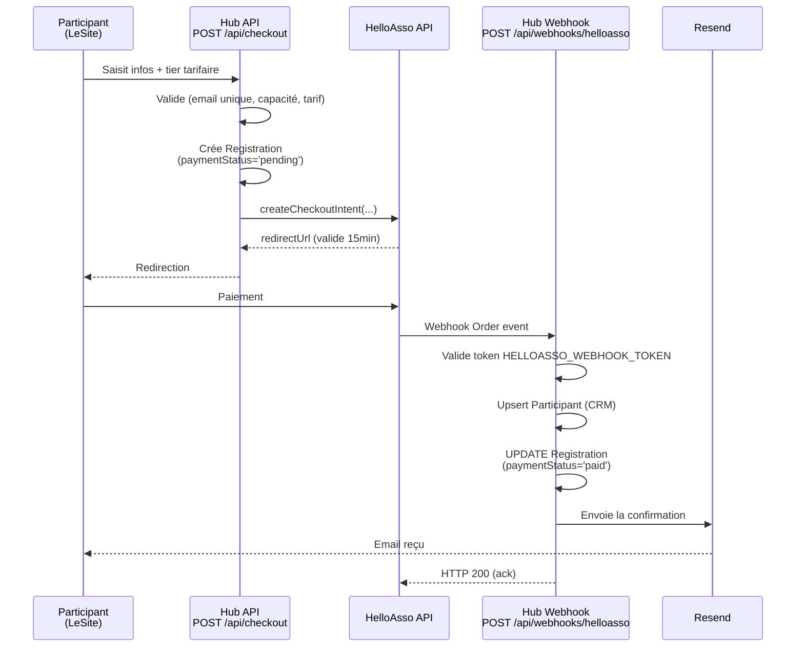
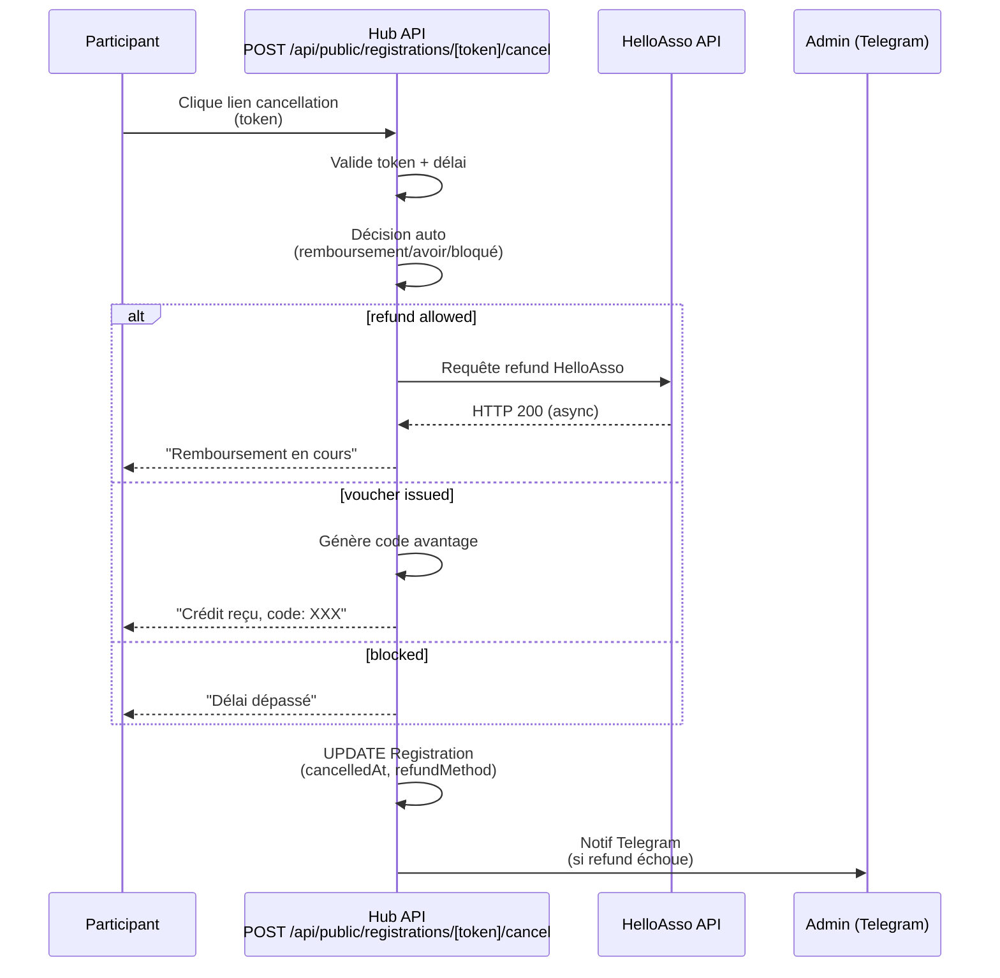
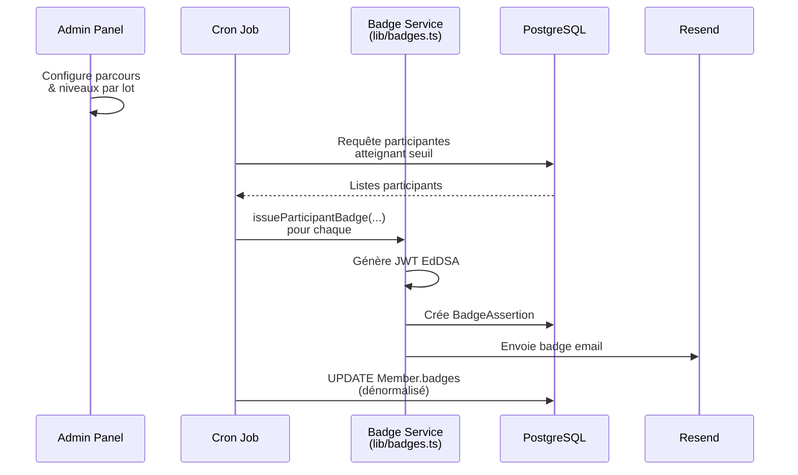
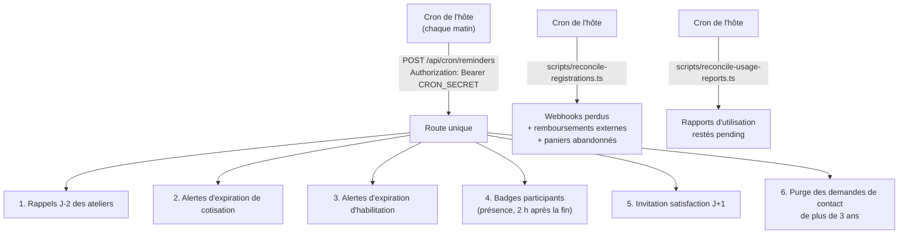
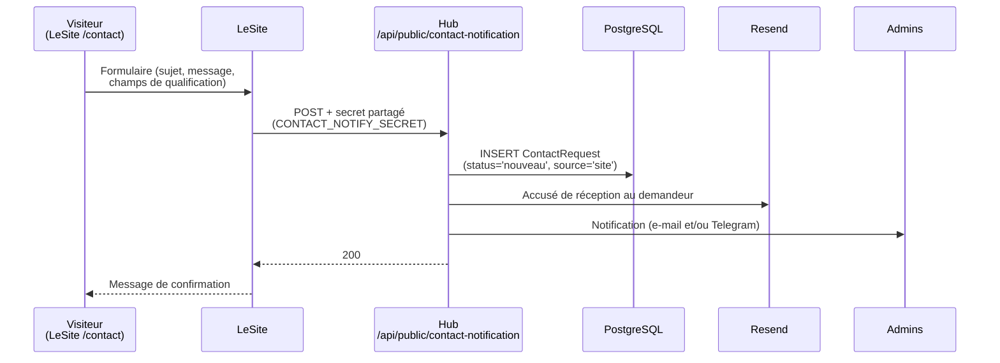
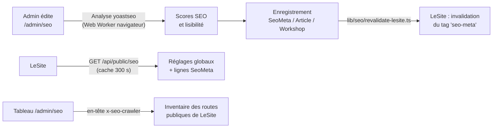
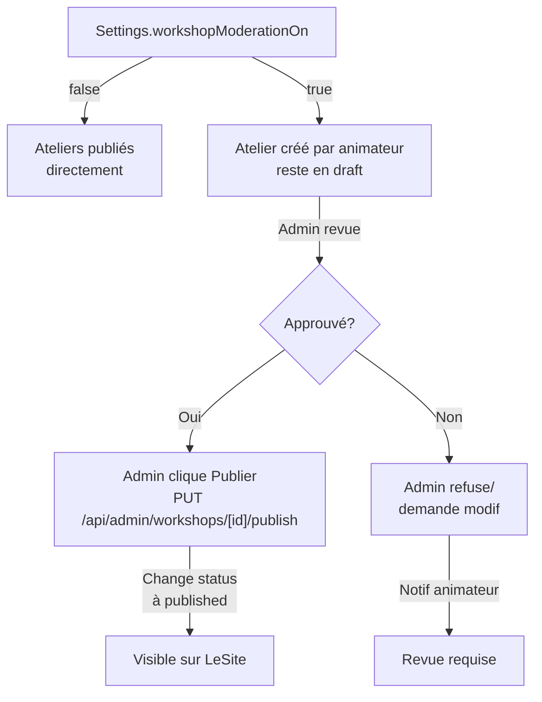

# Flux métier

Les workflows critiques du Hub : inscription + paiement, annulation + remboursement, attribution des badges, demandes de contact, propagation du référencement, tâches planifiées et modération.

## Inscription, paiement et webhook HelloAsso



**Étapes détaillées** :

1. **Saisie inscription** : formulaire capture prénom, nom, email, téléphone (opt), et le tarif choisi dans la grille de l'atelier. Le libellé du tarif est figé sur l'inscription (`Registration.priceTierLabel`).

2. **Validation** (`app/api/checkout/route.ts`, ligne 31 sqq) :
   - Rate limit par IP (10 requêtes / 10 min, `lib/rate-limit.ts`).
   - Vérification email unique (pas encore inscrit avec `paymentStatus='paid'`).
   - Vérification capacité restante (`workshop.capacity - count registrations payées`).
   - Vérification que le tarif demandé existe dans la grille de l'atelier (`lib/price-tiers.ts`) et calcul du TTC au centime (`lib/price-format.ts`).
   - Vérification ateliers futurs seulement.

3. **Création intention de paiement** (`createCheckoutIntent()` dans `lib/helloasso.ts`) :
   - Token OAuth2 HelloAsso (credentials flow, cachés en mémoire).
   - POST `/v5/checkout-intents` avec détails.
   - Retour `redirectUrl` valide 15 min.

4. **Création Registration** :
   - Une `Registration` avec `paymentStatus='pending'`, `helloassoCheckoutIntentId`, `cancellationToken` généré.
   - L'email et le workshop ID sont uniques ensemble (`@@unique([workshopId, email])`).

5. **Redirection vers HelloAsso** : l'app redéploie vers `redirectUrl`.

6. **Paiement** : l'utilisateur paie chez HelloAsso, qui redirige vers `returnUrl?checkoutIntentId=xxx&code=succeeded&orderId=yyy`.

7. **Webhook HelloAsso** (`app/api/webhooks/helloasso/route.ts`) :
   - Valide le token en query string (`?token=HELLOASSO_WEBHOOK_TOKEN`).
   - Extrait `checkoutIntentId` de `data.checkoutIntentId` ou `data.formSlug`.
   - Cherche toutes les `Registration` en attente (`paymentStatus='pending'`) pour ce checkout.
   - Pour chaque registration :
     - Upsert `Participant` par email (CRM).
     - UPDATE `Registration` : `paymentStatus='paid'`, lien `participantId`.
     - Appel Resend pour l'e-mail de confirmation (`sendConfirmationEmail`). Le **reçu de paiement est émis par HelloAsso**, le Hub ne génère aucune facture PDF — la colonne `Registration.invoiceUrl` existe mais rien ne l'écrit.
   - Idempotence : si `orderId` déjà traité, retour 200 immédiate.

**Si le webhook est perdu** :

- Le participant paie mais reste en `paymentStatus='pending'` côté Hub.
- **Réconciliation quotidienne** (cron de l'hôte) : `scripts/reconcile-registrations.ts` relit les commandes HelloAsso des N derniers jours (35 par défaut) et fait basculer en `paid` les inscriptions encore `pending` dont la commande existe. Le script fait trois choses dans la même passe :
  1. rattrapage des webhooks perdus ;
  2. synchro des remboursements décidés depuis le back-office HelloAsso (`lib/refund-sync.ts`) ;
  3. nettoyage des paniers réellement abandonnés — une `Registration` `pending` de plus de 24 h bloquait une place indéfiniment, l'atelier affichant des places libres côté public tout en refusant les inscriptions au checkout.
- Conséquence tant que le rattrapage n'a pas tourné : le participant a payé mais n'a ni confirmation ni place.

## Annulation et remboursement



**Étapes détaillées** :

1. **Lien annulation** : l'email de confirmation contient un lien `https://hub.fresquesystemique.org/api/public/registrations/[cancellationToken]/cancel/` (voir `lib/email-template-defaults.ts`).

2. **Endpoint annulation** (`app/api/public/registrations/[token]/cancel/route.ts`) :
   - Rate limit par IP (10 tentatives / 15 min).
   - Trouve `Registration` par `cancellationToken`.
   - Appelle `cancelRegistration(registrationId)` (`lib/registration-cancellation.ts`).

3. **Logique décision** (`lib/registration-cancellation.ts`) :
   - Lit `cancellationPolicy` (`lib/cancellation-policy.ts`) — délais par événement type.
   - Calcule si annulation encore possible : `workshop.date - 48h` > maintenant ?
   - **Remboursement** : délai ok + paiement accepté → appel HelloAsso refund (async).
   - **Avoir** : délai ok + paiement accepté + refund échoue → génère code avantage unique.
   - **Blocage** : délai dépassé → refuse l'annulation (contact admin requis).

4. **Appel HelloAsso refund** :
   - Requête HelloAsso `POST /v5/refund` (en attente du privilège `RefundManagement`).
   - Actuellement **désactivé** (`Settings.helloassoRefundEnabled=false`) → la refund passe par une **notif Telegram admin** pour traitement manuel.
   - Admin doit refunder manuellement dans l'interface HelloAsso, puis marquer en DB.

5. **Code avantage émis** : `DiscountCode` créé avec `amountOffTTC` égal au montant inscrit, `maxUses=1`, `restrictedToEmail` du participant.

6. **Mise à jour Registration** : `cancelledAt=now()`, `refundMethod` = 'refund' / 'voucher' / 'blocked'.

**Gestion de l'atelier annulé** :

- Admin peut annuler tout un `Workshop` → tous les inscrits payés sont refundés automatiquement.
- Atelier en état `cancelled` : inscrits visibles (lecture seule), animateurs non éditables, atelier non modifiable.

**Si le refund HelloAsso échoue** :

- Notif Telegram admin (via `notifyAdmin()` dans `lib/notifications.ts`).
- Participant voit un message d'erreur mais inscription reste `paid`.
- Admin traite manuellement et met à jour le statut en DB.

**Le sens inverse : un remboursement décidé dans HelloAsso**

HelloAsso ne prévient pas le Hub quand un remboursement est fait depuis son back-office. L'inscription restait alors `paid` : la place occupée, le participant toujours dans la liste et dans les rappels. `lib/refund-sync.ts` rapproche les paiements remboursés de HelloAsso avec `Registration.helloassoOrderId`, annule la participation, prévient le participant et libère la place. Il tourne dans la réconciliation quotidienne.

:::note Clé de rapprochement
C'est `order.id` qui sert de clé, pas le `checkoutIntentId` : la liste des **paiements** de HelloAsso ne renvoie pas le checkout intent, contrairement à la liste des commandes.
:::

## Attribution des badges



**Types de badges** (`lib/badges.ts`) :

| Type | Rôle | Prérequis |
|------|------|-----------|
| `ANIMATOR_PUBLIC` | Animateur grand public | Animateur habilité grand public |
| `ANIMATOR_PRO` | Animateur professionnel | Animateur avec habilitation professionnelle |
| `TRAINER_PUBLIC` | Formateur grand public | Formateur habilité grand public |
| `TRAINER_PRO` | Formateur professionnel | Formateur avec habilitation professionnelle |
| `PARTICIPANT` | Participant | 1+ atelier suivi |

**Émission** :

1. **Par atelier** : cron quotidien (après chaque atelier) requête `WorkshopAnimator` + participants ayant assisté.
2. **Par habilitation** : admin page `/admin/members` attribue `habilitationAnimation`/`habilitationFormation` → badges générés en masse.
3. **Fonction centrale** : `issueParticipantBadge(memberId, badgeType)` qui :
   - Crée un UUID v7 comme `id`.
   - Génère un JWT EdDSA signé (clé privée de `BADGE_PRIVATE_KEY`, voir `lib/badge-keys.ts`).
   - Structure VerifiableCredential OB3 : type, recipientEmail, issuedAt, credentialSubject, proof.
   - Crée une `BadgeAssertion` en DB.
   - Envoie email avec lien badge public.

**Format badge JWT** (VerifiableCredential OB3) :

```json
{
  "iss": "https://hub.fresquesystemique.org",
  "sub": "badge-uuid",
  "aud": "https://w3c-ccg.github.io/vc-api/",
  "exp": ...,
  "iat": ...,
  "vc": {
    "type": ["VerifiableCredential", "OpenBadgeCredential"],
    "credentialSubject": {
      "type": "AchievementSubject",
      "achievement": {
        "id": "https://hub.fresquesystemique.org/badges/[type]",
        "type": "Achievement",
        "name": "Animateur·ice citoyen·ne de la Fresque Systémique",
        "criteria": "..."
      },
      "name": "Prénom Nom"
    }
  }
}
```

**Vérification** (`app/verify/page.tsx`) : saisie d'un ID badge → affichage avec QR code, lien vérification en ligne.

## Les tâches planifiées (crons)

Le Hub n'a **qu'un seul endpoint de cron** : `POST /api/cron/reminders`. Il fait six choses dans une seule passe quotidienne. Les autres tâches sont des scripts lancés par le cron de l'hôte, pas des routes HTTP.



**La route `/api/cron/reminders`** (`app/api/cron/reminders/route.ts`) :

1. **Protection** : vérifie `CRON_SECRET` dans l'en-tête `Authorization: Bearer`. Elle **refuse de tourner** si la variable est absente (fail closed), plutôt que de s'exécuter sans protection.
2. **Rappels J-2** : ateliers dont la `date` tombe entre maintenant +24 h et +72 h. Fenêtre large parce que le cron ne tourne qu'une fois par jour ; la déduplication se fait sur `Registration.reminderSentAt`. Le rappel est le seul e-mail qui porte le lien du plateau pour les ateliers en ligne. Le genre du destinataire est appliqué quand l'inscrit·e a un compte membre, médian sinon (`applyGender()`).
3. **Expirations de cotisation** puis **d'habilitation** (animation et formation) : alertes aux membres concernés.
4. **Badges participants** : émis sur présence pointée, deux heures après la fin théorique de l'atelier.
5. **Invitation au questionnaire de satisfaction** : J+1, fenêtre calculée par `lib/satisfaction-window.ts`, lien vers `/satisfaction/[token]`. L'envoi n'a lieu que si le gabarit `satisfaction_invitation` est activé.
6. **Purge des demandes de contact** : les `ContactRequest` dont le dernier échange dépasse trois ans (`lib/contact-request-purge.ts`). Greffée ici plutôt que sur un cron dédié.

:::warning Il n'y a pas de cron `/api/cron/satisfaction`
L'invitation au questionnaire part de l'étape 5 de la route des rappels. Chercher un cron dédié, c'est chercher ce qui n'existe pas — et un envoi de satisfaction qui ne part pas se diagnostique dans les logs de cette route, ou en vérifiant que le gabarit est activé.
:::

**Le script qui appelle la route** (côté hôte) vérifie le code de retour et prévient par Telegram en cas d'échec : un cron silencieusement cassé est passé inaperçu pendant plusieurs semaines en mai 2026, ce qui a privé des participants de leurs badges.

**Réconciliation des inscriptions** (`scripts/reconcile-registrations.ts`, quotidien) : les trois volets décrits plus haut (webhooks perdus, remboursements externes, paniers abandonnés). S'exécute avec `tsx` depuis le dossier du dépôt sur l'hôte, ce qui suppose que les dépendances et le client Prisma généré y suivent le code déployé.

**Réconciliation des rapports d'utilisation** (`scripts/reconcile-usage-reports.ts`, quotidien) : même principe pour les `UsageReport` restés en `paymentStatus='pending'`.

## Demande de contact depuis LeSite



- Les champs de qualification du sujet « Organiser un atelier » voyagent dans `context`, séparés du message, pour être affichés comme des champs dans `/admin/contact-requests`.
- Un admin peut aussi consigner à la main une demande reçue par téléphone (`source='manuel'`).
- La pastille de la navigation admin compte les demandes encore au statut `nouveau`.
- Conservation : trois ans après le dernier échange, purgés par le cron.

## Propagation du référencement vers LeSite



Deux sens de lecture, qu'il faut distinguer pour debuguer :

- **Hub → LeSite** : les balises `<meta>` du site public viennent du Hub. LeSite appelle `/api/public/seo` une seule fois et met le résultat en cache 300 s sous le tag `seo-meta` ; le Hub invalide ce tag à chaque enregistrement.
- **LeSite → Hub** : le tableau `/admin/seo` ne devine pas les pages à référencer, il demande à LeSite son inventaire de routes publiques. L'appel passe l'en-tête `x-seo-crawler` pour traverser le mode chantier, et exige `LESITE_URL` et `SEO_CRAWLER_SECRET` côté Hub — sans quoi le tableau s'affiche avec un bandeau d'indisponibilité au lieu de la liste des pages.

L'analyse `yoastseo` tourne **dans le navigateur**, dans un Web Worker, jamais côté serveur : le serveur ne stocke que les scores.

## Modération des contenus



**Modération** :

- Flag global `Settings.workshopModerationOn` bascule le mode.
- **Mode off** (défaut) : animateurs publient directement (`status='published'`), atelier visible immédiatement.
- **Mode on** : ateliers créés par animateur restent en `draft`, admin doit cliquer « Publier » pour changer à `published`.
- Endpoint publication : `PUT /api/admin/workshops/[id]/publish` (gating `requireAdmin()`).
- Ateliers figés : une fois un atelier `cancelled`, ses inscrits restent visibles en lecture seule (pour historique).

**CRM modération** :

- Admin `/admin/participants` modère les notes et étiquettes des participants (notes internes, tags texte libre).
- Anonymisation RGPD : soft delete sur `Participant` puis suppression définitive après délai légal.

**Articles modération** :

- Admin `/admin/blog` crée articles en `published=false` (draft).
- Click « Publier » → `published=true` + `publishedAt=now()`.
- Revalidation ISR LeSite sur publication (push de revalidation secret vers LeSite `/api/revalidate`).
