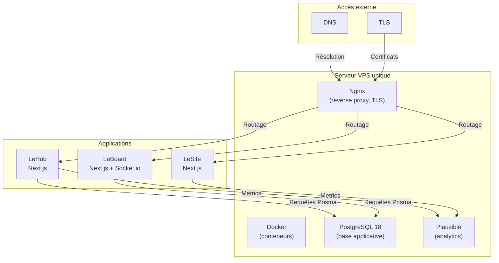

# Infrastructure

## Vue d'ensemble

La Fresque Systémique repose sur une infrastructure cloud simplifiée : un serveur unique (VPS) qui héberge l'ensemble du SI en conteneurs Docker derrière un serveur web Nginx. Les certificats TLS sont gérés automatiquement, et une instance PostgreSQL persiste les données de LeHub et LeBoard.

## Les noms servis par cette machine

| Domaine | Vers quoi |
|---|---|
| `fresquesystemique.org`, `www.` | LeSite (conteneur, port 3002) |
| `hub.fresquesystemique.org` | LeHub (conteneur, port 3000) |
| `board.fresquesystemique.org` | LeBoard (conteneur, port 3001) |
| `badge.fresquesystemique.org` | **LeHub également** : la page publique d'un badge et son image d'aperçu |
| `docs.fresquesystemique.org` | Cette documentation, servie en statique |
| tout autre nom | Vhost par défaut : connexion fermée |

Le VPS héberge aussi des services hors du SI de l'association (site personnel, analytics, DNS filtrant, autres projets). Ils partagent la même machine, le même Nginx et le même disque — ce qui explique qu'une saturation disque ou un build concurrent ailleurs puisse gêner un déploiement du SI.

## Déploiement des applications

### Conteneurs Docker

Chaque application (LeHub, LeSite, LeBoard) s'exécute dans son propre conteneur Docker :

- **Image** : construite depuis le Dockerfile à la racine du dépôt (`npm ci`, build de production Next.js, sortie standalone).
- **Runtime** : **Node 22** (`node:22-alpine`) pour les trois applications — la branche 20 est sortie de maintenance en avril 2026. Les barrières de qualité en CI tournent sur Node 24, qui n'est que la version de vérification des tests.
- **Accès à la DB** : chaque conteneur reçoit `DATABASE_URL` dans son `.env` pour accéder à PostgreSQL.
- **Volumes** : les fichiers d'upload de LeHub sont montés depuis le système de fichiers de l'hôte (voir ci-dessous).

Un orchestrateur (Docker Compose ou équivalent) gère le cycle de vie des conteneurs sur l'hôte.

### Serveur web Nginx (hôte)

Nginx s'exécute sur l'hôte (pas en conteneur). Il assume plusieurs rôles :

- **Reverse proxy** : redirige les requêtes HTTP/HTTPS vers les conteneurs applicatifs selon le domaine (routage par `Host` header).
- **TLS (HTTPS)** : termine les connexions HTTPS, déchiffre et proxy le trafic vers les apps (en clair en interne).
- **Certificats** : gérés automatiquement, renouvellement transparent.
- **En-têtes de sécurité** : un snippet commun, inclus par chaque vhost, pose HSTS, `X-Frame-Options`, `X-Content-Type-Options`, `Referrer-Policy` et `Permissions-Policy`, et masque l'en-tête qui révèle la pile applicative.
- **HTTP/2** : activé sur **tous** les vhosts servis.
- **Limitation de débit et de connexions** : en place depuis le durcissement d'août 2026.
- **Uploads statiques** : les fichiers d'upload de LeHub sont servis directement par Nginx via un alias de système de fichiers, **non par l'application**.

:::warning Les images d'upload sont servies par Nginx, pas par l'application
Les fichiers d'upload de LeHub sont servis directement par le Nginx de l'hôte via un alias de système de fichiers couvrant tout le préfixe `/uploads`, et non par le conteneur applicatif. Une modification de cette configuration exige un rechargement de Nginx. Les chemins exacts sont dans LeRunbook.
:::

### Durcissement : ce qui protège le serveur

Le VPS a été durci en deux lots en août 2026, puis repris lors des audits de septembre. L'essentiel à connaître :

| Mesure | Détail |
|---|---|
| **Vhost par défaut** | Tout nom d'hôte non reconnu (IP nue, sous-domaine supprimé, scanner) reçoit une fermeture de connexion. Sans lui, Nginx servait le **premier vhost par ordre alphabétique** à n'importe quel hôte inconnu |
| **En-têtes de sécurité** | Snippet partagé par tous les vhosts, signature serveur masquée |
| **HTTP/2** | Sur tous les vhosts servis |
| **fail2ban** | Six prisons actives : SSH, et cinq côté HTTP (requêtes malformées, recherche de robots, scans, authentification, trafic tombant sur le vhost par défaut) |
| **SSH** | Authentification par clé uniquement, mots de passe désactivés, configuration durcie |
| **Mises à jour** | Ubuntu Pro avec correctifs du noyau à chaud |
| **Fichiers `.env`** | Permissions restreintes au propriétaire |
| **Nettoyage Docker** | Quotidien par cron, pour éviter la saturation du disque |

:::warning Deux pièges de configuration à connaître
**`add_header` de Nginx n'est pas cumulatif.** Un seul `add_header` dans un bloc `location` annule **tous** les en-têtes hérités du bloc `server`. Le snippet de sécurité doit donc être ré-inclus explicitement dans chaque `location` qui déclare ses propres en-têtes (`Cache-Control`, `Content-Disposition`…), sinon cette location perd silencieusement toute protection.

**`listen ... ssl http2` vaut pour la socket, pas pour le vhost.** Nginx 1.24 n'accepte pas la directive `http2 on;`, et il faut donc poser `http2` sur le `listen` de **tous** les vhosts : un seul oubli et l'ensemble du trafic de cette socket reste en HTTP/1.1.
:::

### Convention de journalisation

Depuis août 2026 :

- les journaux des scripts de l'hôte vont dans un dossier par domaine ou par service, sous `~/logs/` ;
- Nginx écrit **un fichier par vhost**, ce qui permet de lire le trafic d'une application sans démêler celui des douze autres.

### PostgreSQL 18

Une instance PostgreSQL unique s'exécute sur l'hôte ou en conteneur, accessible via TCP depuis tous les conteneurs d'applications.

- **Données** : tous les ateliers, inscriptions, participants, contenus, badges, ainsi que tous les modèles du plateau LeBoard (`Board`, `CardPlacement`, `BoardLotDistribution`, etc.).
- **Migrations** : appliquées au déploiement (`prisma migrate deploy`), qui bloque si une migration échoue. Les deux applications sont sur **Prisma 7**, dont le client est généré hors de `node_modules` et se connecte par l'adaptateur `pg`.
- **Sauvegardes** : sauvegarde régulière (voir page [Sauvegardes](./sauvegardes.md)).
- **Accès hors conteneur** : un administrateur peut se connecter directement pour diagnostic (voir LeRunbook pour les credentials).

### Analytics auto-hébergé (Plausible)

Une instance **Plausible** (outil d'analytics open-source) s'exécute sur l'hôte et collecte les données d'audience :

- **LeHub** : domaine `hub.fresquesystemique.org`.
- **LeSite** : domaine `fresquesystemique.org`.
- **LeBoard** : domaine `board.fresquesystemique.org`.
- **Version** : Plausible CE 3.2.1, avec PostgreSQL et ClickHouse dédiés, sauvegardés eux aussi.
- **Respect vie privée** : pas de cookie, IP anonymisée, conforme RGPD.
- **Données** : accessibles via interface web admin (voir LeRunbook pour accès).
- **Continuité** : même si Plausible redémarre, les apps restent fonctionnelles (analytics est non-critique).

## Certificats TLS

Les certificats HTTPS sont générés automatiquement et renouvelés sans intervention. Ils couvrent tous les domaines servis : `fresquesystemique.org` (et `www`), `hub.`, `board.`, `badge.`, `docs.`, plus les domaines hors SI hébergés sur la même machine.

:::note Un nom résiduel suffit à casser un renouvellement
Le certificat de l'instance Plausible portait encore un nom alternatif dont le DNS avait été supprimé : le renouvellement échouait à chaque tentative, sans que rien d'autre ne le signale. Corrigé le 28 août 2026. Quand un sous-domaine est retiré, il faut aussi le retirer des certificats qui le nomment.
:::

- **Validation** : les certificats sont valides en production et couvrent tous les domaines exposés publiquement.
- **Renouvellement** : le renouvellement est automatique et ne nécessite pas d'action.
- **En cas d'expiration** : si un certificat expire sans renouvellement, les accès HTTPS échouent. Les accès HTTP sont bloqués (redirection HTTPS forcée).

## Résilience et limites

### Limites connues

- **Single Point of Failure** : un seul serveur VPS. Une panne serveur arrête l'ensemble du SI.
- **Capacité** : l'infrastructure actuelle supporte les usages observés (centaines de membres, ateliers mensuels). Une croissance majeure exigerait du scaling (réplicasDB, load balancer, multi-serveurs).
- **Recette en cas de panne grave** : redémarrage manuel du serveur, restauration depuis sauvegarde (voir LeRunbook).

### Sauvegardes

Les données de la base PostgreSQL et des fichiers d'upload sont sauvegardées régulièrement vers un stockage objet externe. Voir la page [Sauvegardes](./sauvegardes.md) pour les détails.

### Monitoring

Un monitoring continu supervise la santé du serveur et des applications. Voir la page [Monitoring](./monitoring.md).
