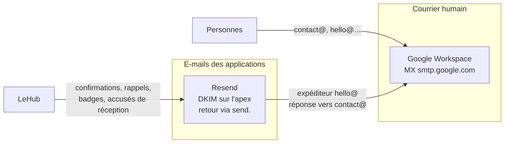

# Les outils de l'association

Le SI ne se réduit pas aux trois applications. Une partie de la vie de l'association se joue dans des outils qu'elle n'a pas écrits : sa messagerie, ses documents partagés, sa coordination, sa communication. Ils ne demandent pas de maintenance de code, mais ils portent des dépendances réelles — et deux d'entre elles touchent directement le fonctionnement des applications.

Cette page les recense et dit ce qui se casse quand l'un disparaît. Les comptes, les adresses nominatives et les procédures d'accès restent dans **LeRunbook**.

## Vue d'ensemble

| Outil | Ce qu'il porte | Lien avec les applications |
|---|---|---|
| **Google Workspace** (Google for Nonprofits) | Les boîtes `@fresquesystemique.org`, le Drive partagé de l'association, les visios Meet | **Fort** : la messagerie humaine du domaine, et les supports d'atelier lus par LeHub |
| **Signal** | La boucle de coordination du bureau | Aucun |
| **Telegram** | Le fil technique : alertes du SI, rapports du monitoring | Fort : c'est le canal d'alerte de LeHub et du serveur |
| **LinkedIn** | La page de l'association, et le réseau des animateur·ices | Moyen : connexion LinkedIn des membres, et attestation de badge |
| **HelloAsso** | Les paiements et leur back-office | Fort : voir [LeHub — Intégrations](../lehub/integrations.md) |
| **Resend** | Les e-mails transactionnels | Fort : voir [LeHub — Intégrations](../lehub/integrations.md) |
| **Plausible** | La mesure d'audience, auto-hébergée | Faible : aucune panne fonctionnelle s'il tombe |

## Google Workspace

L'association est sur **Google Workspace via Google for Nonprofits**, l'offre gratuite réservée aux structures éligibles. Trois usages :

- **Gmail** : les boîtes du domaine `@fresquesystemique.org`. C'est la messagerie humaine, à ne pas confondre avec les e-mails envoyés par les applications (voir la section suivante).
- **Drive partagé** : les documents de l'association — comptes rendus, modèles, supports. C'est là que vit ce qui n'est pas dans la base de données.
- **Meet** : les visios, pour les réunions comme pour l'animation d'ateliers en ligne.

### Deux dépendances à connaître

:::warning Le support d'atelier de LeHub dépend d'un compte Google
LeHub lit et exporte les présentations Google Slides avec un **jeton de rafraîchissement OAuth** obtenu une fois pour toutes (`GOOGLE_OAUTH_REFRESH_TOKEN`, cf. `scripts/google-slides-oauth.ts`). Ce jeton appartient à un compte Google qui a accès aux présentations.

Si ce compte est supprimé, si ses accès au Drive changent, ou si le jeton est révoqué, **l'éditeur de version de cartes perd la liste des présentations et les diapositives cessent d'être exportées** — y compris pour LeBoard, qui les relaie. Le symptôme est un bandeau d'échec de chargement, pas une erreur explicite. Le remède est de rejouer le script d'autorisation, pas de redéployer.

Conséquence organisationnelle : ce jeton ne doit pas dépendre du compte personnel d'une seule personne.
:::

:::warning Google for Nonprofits se revérifie
L'éligibilité au programme est à reconfirmer périodiquement auprès de Google. Une vérification laissée de côté peut aboutir à une suspension du compte — donc à la perte de la messagerie du domaine et de l'accès au Drive, en même temps.

À quoi s'ajoute la règle habituelle des comptes nominatifs : les fichiers créés par une personne lui appartiennent. Au départ d'un membre du bureau, la propriété des documents doit être transférée **avant** la fermeture de son compte.
:::

## La chaîne e-mail : deux chemins pour un seul domaine

C'est le point le plus souvent mal compris du SI, et il se lit entièrement dans le DNS du domaine.

| Enregistrement | Valeur | À quoi il sert |
|---|---|---|
| `MX` de l'apex | Google | Reçoit tout le courrier du domaine |
| `SPF` de l'apex | `include:_spf.google.com` | Autorise Google à envoyer pour l'apex |
| `DKIM` `resend._domainkey` | clé Resend | Signe les e-mails des applications **au nom de l'apex** |
| `SPF` et `MX` de `send.` | infrastructure d'envoi de Resend | Chemin de retour des e-mails transactionnels (rejets, plaintes) |
| `DMARC` de l'apex | `p=quarantine` | Un message non aligné part en indésirable |

:::danger Ne pas « nettoyer » les enregistrements qui semblent inutiles
L'apex n'autorise que Google en SPF : les e-mails des applications sont alignés **par leur signature DKIM**, et leur chemin de retour passe par le sous-domaine `send.`. Retirer la clé DKIM, ou les enregistrements de `send.` parce qu'aucun humain n'y a de boîte, fait tomber la délivrabilité de toutes les confirmations d'inscription — sans aucune erreur dans les journaux du Hub, qui considère l'envoi comme réussi.

La règle générale du domaine, déjà apprise une fois sur un certificat : **un enregistrement DNS qui ne sert visiblement à rien sert peut-être à quelque chose qui échoue en silence.**
:::

Côté réglages, l'expéditeur et l'adresse de réponse sont éditables dans `/admin/settings` → Email, avec deux adresses supplémentaires possibles par catégorie (facturation, support). Ce sont des valeurs de base de données, pas des variables d'environnement.

## Signal : la boucle du bureau

La coordination courante du bureau se fait dans une **boucle Signal** : points d'étape, arbitrages, urgences. C'est le canal des personnes, pas celui des machines.

**Ce qui doit en sortir.** Une boucle de messagerie n'est pas une archive : pas de recherche partagée fiable, pas de reprise par un nouveau membre, et des messages qui peuvent disparaître. Toute décision qui engage l'association a donc sa trace ailleurs — compte rendu dans le Drive partagé, ou l'outil concerné quand il s'agit du SI (un atelier se décide dans le Hub, pas dans un fil).

**Ce qui n'y a pas sa place.** Aucun identifiant, aucune clé, aucun mot de passe : ils vivent dans les réglages des applications ou dans LeRunbook.

:::note Signal pour les humains, Telegram pour les machines
Les alertes techniques — monitoring du serveur, échecs de cron, remboursements à traiter, notifications d'administration du Hub — partent sur **Telegram**, via un bot distinct. Ce n'est pas une hésitation entre deux outils, c'est une séparation utile : un canal qu'on lit quand on travaille, et un canal qui réveille. Mélanger les deux revient à noyer les décisions du bureau sous les rapports quotidiens du serveur, ou l'inverse.

Voir [Monitoring](./monitoring.md) pour ce qui est effectivement envoyé.
:::

## LinkedIn

La page de l'association porte sa communication publique. Deux liens avec les applications, qu'il faut distinguer :

- **Connexion des membres** : LeHub propose une connexion LinkedIn (OAuth). Une première connexion sans compte existant passe par une liaison explicite à un compte déjà en base, elle ne crée pas de membre.
- **Attestation de badge** : la page publique d'un badge propose de l'ajouter au profil LinkedIn comme certification. Le lien passe l'identifiant de l'organisation, codé dans `lib/urls.ts` de LeHub. **Si la page LinkedIn de l'association change d'identifiant, ce lien pointe vers une organisation qui n'est plus la bonne** et il faut mettre à jour cette constante.

## Ce qui vit où

Un repère utile quand on cherche une information et qu'on ne sait pas par où commencer :

| L'information | Où elle vit |
|---|---|
| Un atelier, ses inscrits, ses tarifs, ses animateur·ices | LeHub (base de données) |
| Un contenu publié (article, page, référencement) | LeHub, affiché par LeSite |
| Le matériel pédagogique (cartes, lots, Régénération) | LeHub, joué par LeBoard |
| Un support projeté en atelier | Google Drive (Slides), lu par LeHub |
| Un compte rendu de réunion, un modèle de document | Google Drive |
| Une décision du bureau | Signal pour l'échange, Drive pour la trace |
| Un paiement, un remboursement | HelloAsso, reflété dans LeHub |
| Une alerte technique | Telegram |
| Un accès, un identifiant, une procédure serveur | LeRunbook (dépôt privé) |
